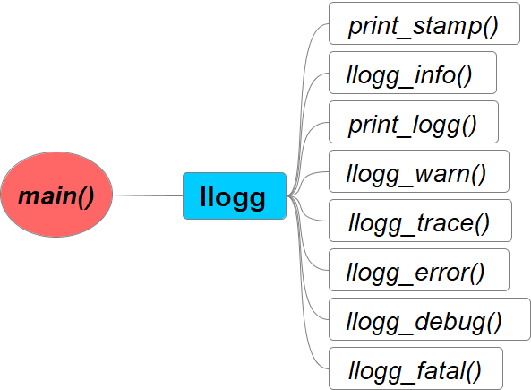

# llogg
> Simple logger library 



## Build library
### Manually
```sh
g++ -c llogg.cpp -o llogg.o && ar rcs libllogg.a llogg.o
```
### Makefile
```sh
make clean lib
```
### CMake
```sh
mkdir build && cd build
cmake -DCMAKE_BUILD_TYPE=Release -DCMAKE_INSTALL_PREFIX=$HOME/my_libs ..
cmake --build .
cmake --install .
#cmake --build build --target install
```
### Meason
```sh
meson setup "build-meson" && meson compile -C "build-meson"
```
## Use library
### Manually
```sh
g++ main.cpp libllogg.a -o test
```
### Makefile
```sh
make clean all
```
